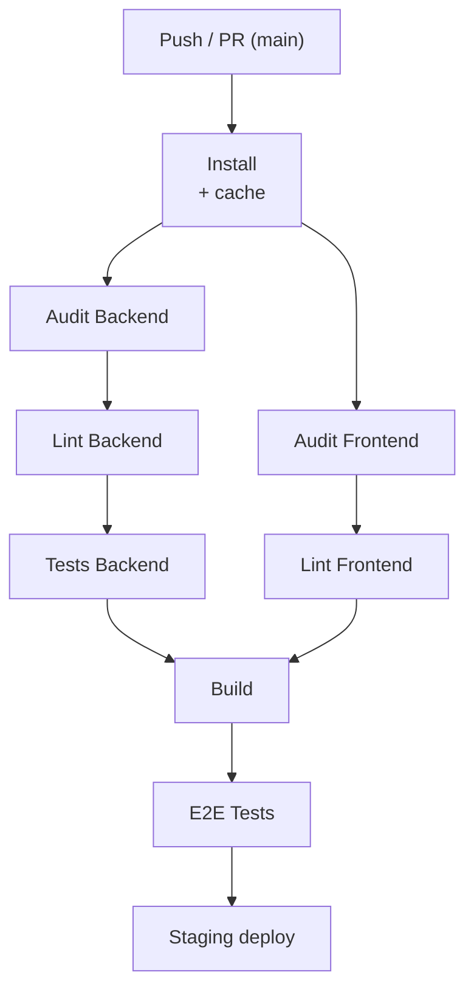

# Schéma du workflow CI/CD — v2

Version simple. Source : CdC §7.3.1 et issues du repo.

- Trait plein : étape obligatoire.
- Pointillé : action manuelle.
- La prod n'est jamais déployée automatiquement.
